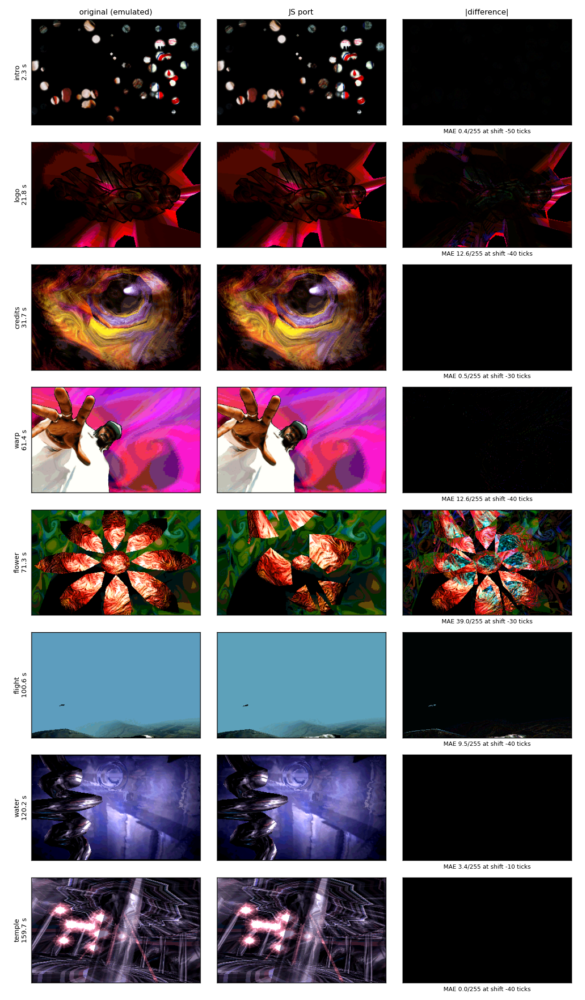
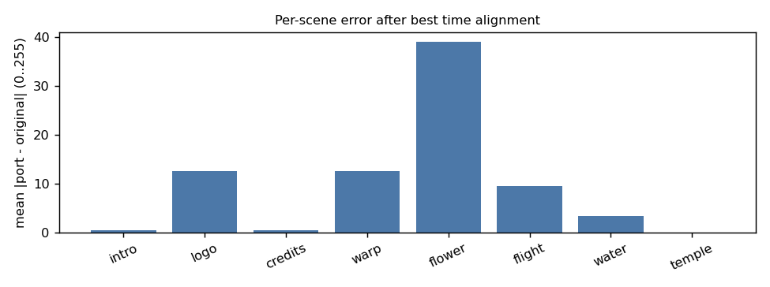
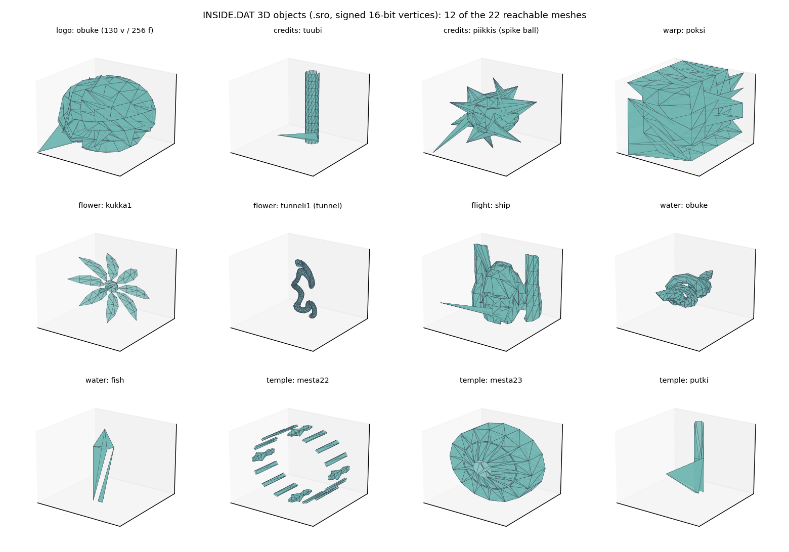

# INSIDE (CNCD, 1996) - effects, 3D engine, tricks, objects and scenes

*INSIDE* by **CNCD** (code: wili, jouni, juliet; graphics: destop; music: Yolk & Legend; sound: DSMI by OC/Virtual Visions; extender: PMODE/W), released at The
Gathering 1996. 113 KB of executable, a 2.7 MB LZSS-packed `INSIDE.DAT` (96 files), a 4-channel-ish AMF module `EYE.AMF` (677 KB). 182.75 s.

## 0. At a glance

*Figure: one frame of each scene, the original run headless under emulation (left), the JavaScript port (middle) and the absolute difference (right). The golden run starts a scene "frames since its trigger", so the port frame is matched with the best time shift (printed under each row).*

*Figure: mean absolute RGB error (0-255) per scene after that alignment. The temple is bit-exact; the flower scene's error (39) is not a timing shift (a search over +-400 ticks does not lower it): its vertex shades contain `rand()` (section 4), the port embeds the table dumped from one reference run, and this golden run, started 'frames since the trigger', draws a different one, so the petals differ. The scene's own comparison (75 % of the frames pixel-exact, see its section) uses the matching table.*

*Figure (3D): twelve of the meshes in `INSIDE.DAT` (`.sro`: signed 16-bit vertices, triangle faces). An interactive viewer (three.js, orbit/zoom/wireframe) is in [`web/viewer3d.html`](web/viewer3d.html). Regenerate with `python3 tools/make_figures.py` (after running `golden.py` and `render_node.mjs` for the START times listed in the script) and `python3 tools/export_meshes.py > web/assets/meshes.json`.*

## 1. Display and timing

* **VGA mode 13h, 320x200, 256 colours.** The pixels are **not square**: a CRT shows 320x200 on a 4:3 screen, so each pixel is 1.2 times taller than wide. The engine knows:
  its vertical focal length is `fy = fx * 5/6` (`fx = 42*128 = 5376`, `fy = 4480` for the logo's fov 42; 200/240 = 0.8333). The port draws the real 320x200 index
  buffer into a canvas stretched to a 4:3 box.
* **One tick = 3.5 ms, 285.714 per second.** A PIT interrupt phase-locked to the vertical retrace (see the asm write-up, snippet 14) calls the scene's
  *A callback* four times per refresh. The frame function *B* runs from the main loop as fast as it can. Everything the demo shows is a function of the tick counter,
  not of the frame number, except a few accumulations per rendered frame (water, temple pages).
* **The script is keyed on the music.** A 97-entry table `{order, row, handler}` (0x1032e4) is compared with the DSMI position every main-loop iteration. 1 row =
  22 ticks = 0.0769 s. The handlers either start a scene (two callbacks: A per tick, B per frame), stop it, or fire a palette operation (white flash `0x1c498`, inverted
  flash `0x1c454`, fade to black `0x1c438`). **The demo timeline is the song position**, which is why the port can seek: it sets the module position and re-renders a pure
  function of the tick.
* **Palette is a first-class effect.** Fades and flashes are float32 ramps run from the tick ISR (snippet 15), not scene code.

## 2. Timeline

| time | order:row | scene | what you see |
|---|---|---|---|
| 0:00 - 0:19.6 | 0:00 - 3:63 | **intro** | still picture revealed by wandering "light drops" |
| 0:19.6 - 0:29.5 | 3:63 - 5:63 | **logo** | the CNCD logo, a camera *inside* a spinning spiky star |
| 0:29.5 - 0:59 | 5:63 - 11:63 | **credits** | flight through a procedural tube, credit names, then a spike ball |
| 0:59 - 1:08.9 | 11:63 - 14:00 | **warp** (nigga 1/2) | big sprite behind a 2-texture warped grid |
| 1:08.9 - 1:38.4 | 14:00 - 19:63 | **flower** | environment-mapped, morphing flowers in a textured tunnel, flashes |
| 1:38.4 - 1:58 | 19:63 - 23:63 | **flight** | heightfield landscape with fog, three env-mapped ships, sun and lens flares |
| 1:58 - 2:16.6 | 23:63 - 27:48 | **water** | corkscrew, fish and a ripple-refraction picture |
| 2:16.6 - 2:27.6 | 27:48 - 29:63 | **warp** again | variants 3/4 |
| 2:27.6 - 2:37.5 | 29:63 - 31:63 | **twirl** | 5 variants of the polar-table spiral warp |
| 2:37.5 - 3:02.8 | 31:63 - 36:24 | **temple** (tunnel2) | glass temple, light beams, ten flares; fade-out at 35:48 |

## 3. The 3D engine ("Surrender")

A complete software engine, written for this demo and then re-used scene after scene. `re/notes_engine.md` has every offset; the structure:

* **Scene graph**: nodes of 0xc8 bytes (position int32, 3x3 `double` matrix at +0x28, parent chain, flags), meshes (vertex 0x40 B, face 0x34 B, material 0x44 B), lights
  (range + peak), billboards (flare/sun/smoke), 2D sprites (types 1..4). Matrices are doubles; **the rotation of an object is accumulated per tick** (`M *= Rinc`
  in the ISR callback), which is why the port keeps checkpoints and replays.
* **Per frame**: camera-space transform (`d = Mcam^T (obj - cam)`, vertex positions in 1/128 units), projection to 28.4 fixed point screen coordinates, outcodes for the
  4 sides + near plane, back-face cull by integer face normal, per-vertex lighting (`I = (peak - |D|*peak/range) * n.D/(|D|*512)`, shade 0..0x3e0, table row = shade>>5),
  near-plane clipping into up to two triangles, **radix sort of faces by mean depth** (painter's algorithm, 3 passes of 8 bits), then the face functions.
* **Six face functions, all "table driven"**. There is no true colour arithmetic anywhere: the lookup tables do the maths.

| fn | name | per pixel |
|---|---|---|
| 0x30e5c | GOURAUD | `shade[(s>>16)<<8 + tex[u,v]]` |
| 0x2edb0 | TEX | `tex[u,v]` (flat) |
| 0x2e264 | GOURAUD2 | `shade2[s2<<8 + shade[s1<<8 + tex]]` (shade + fog) |
| 0x3269c | BLEND | `shd[tex<<8 + dst]` (translucency through a 64 KB table) |
| 0x32dc8 | SHADEDST | `shd[s<<8 + dst]` (darken/lighten the existing pixel, gouraud) |
| 0x332e0 | LIGHTMAP | `shade[lmap[u2,v2]<<8 + tex]` |

  Each has an affine and a perspective-correct version (spans of 2^(n-1) pixels with a reciprocal per span), selected per face by bits 10..12 of its flags. **Every scene
  of the demo uses the affine version** - the textures hide it.
* **Environment mapping** (`0x36cc4`) is the only uv generator ever enabled: `u,v` from the transformed vertex normal, giving chrome flowers, glass and metal fish
  for free with a 256x256 picture.
* **Shade tables**: the `.shd` files (16 KB = 64 rows x 256, or 64 KB = 256 x 256) map `(level, colour)` -> colour. The palettes were built to make this work (ramps
  of 64 levels per base colour group); `.int` and some `.shd` are *blend* tables, `.qnt` quantisation/ light tables, `.sdw` shadow tables, `.fog` fog tables.
* **Sprites**: 4 types: copy, table blit, colour-keyed copy, keyed table blit. The "credit names" and the dark corner masks are type 4/2 sprites.
* The **port** (`web/js/engine3d.js`, 43 KB) reproduces this bit-exactly in palette-index space: 180/180 recorded random triangles identical on every face function, the logo scene
  278/278 frames identical. Everything is reverse-engineered, not approximated, except the points flagged in the README.

## 4. Scene by scene

### 4.1 Intro (0 - 19.6 s) - light drops
A 320x200 picture (`intro/intro.raw`) is *revealed* by light. 130 "drops" (position f32, energy) deposit light into a 16-bit light buffer; each frame the buffer is smoothed in
place (`(4c + l + r + u + d)/8`, so it diffuses), then `fb[i] = intro.shd[clamp(light,0,63)<<8 | pixel]` - the 64-row shade table maps the picture to 64 brightness levels.
The emitter centre is a random walk driven by sines (`A0 += sin(.02t)*47 + cos(.0232t) + sin(.0369t)*4.4` ...), re-rolled by `rand()` when it leaves the screen; each drop
has a 1 in 20 chance per frame to respawn near it with a random energy. A dark disc of radius 60 around (80,80) is never lit (the drops are rejected there). After 14.77 s all
130 drops respawn with high energy: the picture floods with light. *Ported pixel-exact.*

### 4.2 Logo (19.6 - 29.5 s) - the camera is inside the star
`logo/obuke.sro`: a spiky star of **130 vertices, 256 faces**, radius ~516. The camera sits at (0,0,100), i.e. **inside** the star, looking down +Z; the star
rotates about three axes (`R = Euler(-0.01, 0.00867, 0.0123)` per tick), a point light sits at the origin (range 550, peak 1600). Every face is textured with a
256x256 *twirl* texture (`twlogo.raw`) and lit through `logo.shd`. Half of the faces cross the near plane each frame: the logo scene is the heavy exerciser of the near-clip
code. Over it: the "logo mask" (`inmask.raw`, 253x147, values 0..15) darkens the star through `inmask.shd` in the shape of the letters (a drop shadow), and from
22.15 s the "INSIDE" text (`inside.raw`, 249x139, colour key 0) is drawn 3 px right, 4 px down. *Ported bit-exact.*

### 4.3 Credits (29.5 - 59 s) - the tube
A flight through a **procedural tube**. `credits/tuubi.sro` has **11 rings x 12 vertices (132 vertices, 240 faces)**, scaled 7.0, and the **same 11 rings are re-skinned
every frame** from a 1024-ring flight-path table (each row: ring centre, 12 brightnesses, 12 radius factors 0.67..1.6; generated at start-up by ~20 summed sines plus
`rand()`; the port embeds the 110 KB table). The texture (`tunnel.raw`, 256x1024) scrolls one ring per 10 path rings; each vertex shade is brightness minus an
linear distance fog (asm snippet 10). The camera follows the path with exponential smoothing (`S1 = 0.8 S1 + 0.2 P`) and a 1 degree/tick roll; **12 additive
smoke billboards** (`sauhu.raw` 64x64 + `smoke.shd`) float along the path (the bright orbs). At 7:00, 7:32, 8:00, 8:32, 9:00, 9:32 a white flash introduces the next credit
name (DESTOP, WILI, JOUNI, JULIET, YOLK & LEGEND: `kredu*.raw` blended with `tunnel.int` at (0,117)); at 9:48 the **spike ball** `piikkis.sro`
(**252 vertices, 260 faces**, environment-mapped with `piikkis.raw`) catches the camera (its follow offset decreases by 0.015 ring/tick). The border mask `wtrmask.raw` darkens
the screen edges until then. *839/841 frames bit-exact.*

### 4.4 The warp grid, "nigga" (59 - 68.9 s and 136.6 - 147.6 s)
A big transparent sprite (a person; `sprite1/2/4/9.raw`) in front of a **warped, rotating 8x8-vertex grid** (7x7 quads, 98 triangles) that is textured with **two textures at once**: each
vertex has two uv pairs `(512i + aA sin a + aB sin b + aC sin c, 512j + ...)` driven by three phase accumulators, and the rasteriser `0x33a82` outputs
`shd[tex2[u2,v2]<<8 | tex1[u1,v1]]` - the `.shd` here is a 256x256 *blend* table, so two scrolling textures interfere into a liquid pattern. The event at 61.5 s and 146.4 s flips the sign
of the warp frequencies. Variants 3 and 4 (second pass) add a room box (`poksi.sro`, **98 vertices, 192 faces**, 2688 x 6600 x 6000 units), a lit gouraud floor and a shadow quad
(`shadow4/9.raw`, `.sdw`). The port reproduces variants 1 and 2 (~96 % identical pixels, the rest +-1 texel) and variants 3/4 bit-exactly (0 differing pixels): the room is the engine's `poksi.sro` box at scale 8, drawn with per-triangle material uvs (the mapper prologue 0x37e48 copies 3 uv pairs from the material into the vertices), lit by one animated point light, with a 16 level `BLEND` shadow quad; camera, light and shadow vertex are closed forms of the tick counters (see `re/notes_nigga.md`).

### 4.4b Flower (68.9 - 98.4 s) - morphing chrome flowers
A **tunnel** (`tunneli1.sro`, 20 KB, **732 vertices, 1440 faces**: faces >= 350 hidden, a sliding window of visible faces at 0.75 faces/tick) is textured (`jeesus1/2.raw`) with a **per-quad material
rectangle** - no per-vertex uv; the prologue `0x37e3c` copies the material's uv rectangle into each triangle and scrolling is six dword writes per frame (3.7 texel/tick).
Its vertex shades come from a table: `300 sin(.05x) cos(.04y) + 700 sin(.04926 i) + rand()%600 - 300`. In the middle: **a flower** from 10 morph targets
(`kukka1.sro`, `kukka1-2..8`, `kukka2*.sro`, each **~110 vertices, ~125 faces**, 2.3 KB) blended with `t = |sin(phase)|` (period 157 ticks), environment-mapped
chrome (TEX, unshaded), spinning (`euler(ax[idx], spin, 0)`, spin += 0.02/tick), parented to the camera 1500 units ahead. The 9 open/close events (14:24 .. 19:12) alternate
white and inverted flashes and switch to the next shape. The camera follows a **LightWave scene** (`tunnel1.lws`, 2631 bytes) with spline-interpolated keys
(Catmull-Rom, scale 3000), evaluated at sub-frame resolution (asm snippet 4 of `notes_flower`). *75 % of the golden frames pixel-exact, the rest differs on flash frames.*

### 4.5 Flight (98.4 - 118.1 s) - terrain, ships, lens flares
A **heightfield landscape** with **fog**: a 128x128 height table (sum of sin/cos terms, smoothed and mirrored; each cell `{height, shade}`) is rendered as a 19x19-vertex window
(648 faces) following the camera, centred on the camera cell; texture coordinates `u = ((gx%18)+c)*8192/36` so the 512x512 `map.raw` tiles with a period of 18 cells without popping. Per-pixel
`fog[fl][shd[sl][tex]]` is three chained table lookups (asm 1). **Cell shade from the slope**: `cos(atan(dh*k)+c)` computed with *one* `fpatan` (`atan2(y,1)`). **Three env-mapped
ships** (`ship.sro`: **200 vertices, 399 faces**; river picture as environment) fly a rand()-steered formation; the camera follows with its own jitter. The **sun** (`sun.raw`, 128x128,
keyed on the sky colour) and **8 lens flares** (lens1..5.raw: 74x63, 52x43, 31x23, 12x11, 4x4, plus the additive `flare.shd`) are placed along the line from the screen centre through the
sun, `C + k(S-C)` with k = 0, -0.2, 0.5, 0.3, -1.3, -0.9, -0.47, -2.0, only when the sun is within the screen +-12 px. *Approximate*: the ships' env normals, the exact span rounding.

### 4.6 Water (118 - 136.6 s)
* a 320x200 picture (`water.raw`) seen through **a ripple simulation** (asm snippet 7); **8 fish** (`fish.sro`, **8 vertices, 10 faces**, scale 0.15) swim by a sine formula
  `S = sin((t+171i)*0.00158) + cos((t-57i)*0.0027) + 0.1 cos(t*0.0081)` (heading += S degrees, speed max(30 S + 10, 15)), turn around when they leave the screen, and **each fish's
  screen position drops a splash** in the wave buffer (the triangle-shaped wedge of snippet 12): the fish stir the water. Their 4,5,6 vertices and normals wiggle with sines (the
  normals drive the env map, so the picture swims over the fins). Drawn through `water.int` (BLEND) over the ripples;
* a **corkscrew** (`water/obuke.sro`: **287 vertices, 570 faces**, scale 0.6), env-mapped with `waterenv.raw`, spinning 0.84 turns/s about its own axis;
* 3 random raindrops per frame (a 1 in 200 chance each) add 7x7 impulses.
*Bit-exact (528/528 frames) — the rand() state and tick phase are the only free constants, stored in `waterdata.js`.*

### 4.7 Twirl (147.6 - 157.5 s)
The `jeesus1/2`, `nigga2/4` and `river` pictures spiral under a **precomputed polar table**: the original builds, once at start-up, a 64000-entry table mapping each screen pixel to
(radius byte, angle byte); per frame only 256 words `W[r]` are rebuilt from four float32 phase accumulators and two sines, and every pixel does
`tex[ T1 + W[T0] ]` (asm snippet 8). Five parameter sets, switched at 30:24, 30:48, 30:12, 31:36 with a white flash and a palette swap (the table is walked in order so 30:12 fires together
with 30:48, an oddity the port reproduces). *Pixel-exact except around flashes.*

### 4.8 Temple (157.5 - 182.75 s)
A dark **glass temple** viewed by a camera in orbit (parent pivot spinning 0.01 rad/tick, camera roll 0.005, zoom `0.6 + 0.3 sin(...)`):
* `mesta21.sro` (49 v / 84 f) opaque env-mapped; `mesta22.sro` (192 v / 256 f) **glass** (BLEND through `temple.int`, env-mapped); `mesta23.sro` (173 v / 268 f) gouraud with its own uv, lit by
  a breathing point light (range = |sin| * 1000);
* three **light beams** `putki.sro` (15 v / 20 f each, scaled 1.5,1.5,5.3 / 3,3,4.6), drawn with SHADEDST (they light up what is behind them), whose vertex shades slide on one sine (asm 13);
* **ten additive flares** (billboards of `flare.raw` 128x104 sorted *with the mesh faces* in the same radix list, so glass can occlude them);
* **no screen clear**: the two page buffers alternate, so uncovered pixels keep the colour of the frame two frames earlier (cracks between faces glow with a trail); the port replays the
  frames in two buffers to get them right. Fade-out from 35:48, the demo stops at 36:24.
*Bit-exact up to a sub-pixel error on one billboard edge.*

## 5. Cool tricks (summary)

1. **Self-modifying inner loops** with texture/table base and shifts/masks patched into immediates; the left/right edge opcode patch (asm 1, 2).
2. **Table-driven pixel maths**: gouraud, fog, translucency, additive flares, shadow, interference between two textures are all lookups in 16 KB or 64 KB tables
   whose index is built from two byte registers (`ch:cl`, `dh:dl`, `ah:al`).
3. **Precomputed warps**: twirl = 64000-entry polar table + 256-word wobble (8 instr/pixel); the credits tube = 11 reskinned rings + a scrolling texture; the intro = diffusion + one lookup.
4. **Procedural geometry from the same tools**: the tube, the terrain, the grid are *the same mesh objects* (vertex/face lists) with vertices rewritten each frame; seam vertices patched into faces.
5. **Vblank-locked 285 Hz tick** that decouples animation from the frame rate, and a script keyed on the *music* position.
6. **Palette effects in float**, not in the scenes.
7. **Painter's algorithm with a radix sort**, billboards inserted in the same list.
8. **Bugs kept in the art**: the wedge-shaped splash, `y > 199` fixup writing x, a scene that never clears its buffers (the glass temple's trails).

## 6. Asset catalogue (INSIDE.DAT, 96 files, LZSS)

The container (loader 0x1c0e8): `u32 usize` + LZSS stream (flag byte LSB first, 1 = literal; 0 = 2-byte match: distance `b0 | (b1&0xf0)<<4`, length `(b1&15)+3`); the unpacked
2,721,868 bytes end with a directory of 0x30-byte entries `{name[0x20], size, offset, pad[2]}` and a final count. `tools/dat.py` unpacks it (`re/dat_listing.txt` lists all 96 entries);
`web/js/dat.js` reads it in the browser. Formats:

| ext | format |
|---|---|
| `.raw` | 8-bit palette-indexed pixels (320x200, 256x256, 512x512, 256x1024 or sprites of free size) |
| `.pal` | 768 bytes, 256 x RGB, 6-bit VGA values |
| `.shd` | 64 or 256 rows x 256: shade or blend table |
| `.int .qnt .sdw .fog` | auxiliary 256x256 / 128x256 / 64x64 tables (blend, light levels, shadow, fog) |
| `.sro` | `u32 0x001df020, 0x20, nverts, faceofs, nfaces`, then vertices `{i16 x,y,z; u16 u,v; u16 0}` (12 B) and faces `{u16 0; u16 i1,i2,i3}` (8 B). Some files have a 0x14-byte header whose first dword is a size, not the magic: the loader ignores it. |
| `.lws` | LightWave scene text (only `flower/tunnel1.lws`) |

Scene objects: logo `obuke` 130 v / 256 f; credits `tuubi` 132 v / 240 f, `piikkis` 252 v / 260 f; nigga `poksi` 98 v / 192 f; flower `tunneli1` 732 v / 1440 f, `kukka1..` 111 v / 125 f (kukka2: 109 / 129) x 11 targets;
flight `ship` 200 v / 399 f; water `obuke` 287 v / 570 f, `fish` 8 v / 10 f; temple `mesta21` 49/84, `mesta22` 192/256, `mesta23` 173/268, `putki` 15/20 (x3). The whole DAT
contains duplicates that the program can never reach (3x `temple/putki.sro`, 2x `flower/kukka1.sro`, because the lookup is a linear `strcmp`, first match wins).

## 7. How the original was reverse engineered

1. `INSIDE.EXE` is PMODE/W (LE-style stub with compressed objects): `re/unpack_pmodew.py` runs the PMODE/W loader under **Unicorn** and dumps the 64 MB guest memory at the program
   entry (`mem0.bin`), so every address is a linear address into a pristine image.
2. `re/emu.py` boots the real program (flat model, stub DOS/VGA/DMA/PIT) and `re/golden.py` runs it headless with a virtual 285.7 Hz clock: **ground-truth frames** for every scene.
3. Per scene, a reverser located the start handler in the 97-entry script table, walked A/B, extracted tables from live memory where they depended on `rand()`, and ported the code
   to `web/js/scenes/*.js`; correctness measured against the golden frames in *palette-index space* (0 differing pixels = bit-exact) and with `tools/cmp.py` in RGB.
